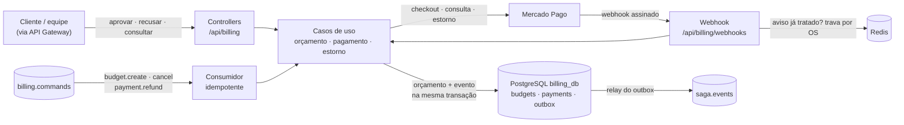

# oficina-billing-service

[](https://sonarcloud.io/summary/new_code?id=Luizustavo_oficina-billing-service) [](https://sonarcloud.io/summary/new_code?id=Luizustavo_oficina-billing-service) [](https://github.com/Luizustavo/oficina-billing-service/actions/workflows/ci.yml)

Billing Service da oficina mecânica (Tech Challenge SOAT, Fase 4): orçamento, aprovação pelo cliente, pagamento pelo **Mercado Pago Checkout Pro** e estorno.

É um dos três microsserviços do sistema:

| Serviço | Responsabilidade | Banco |
|---|---|---|
| [`oficina-backend`](https://github.com/Luizustavo/oficina-backend) (OS Service) | Ordem de serviço, clientes, veículos, catálogo, estoque. **Orquestra a saga** | PostgreSQL (`oficina_db`) |
| **`oficina-billing-service`** | Orçamento, aprovação, pagamento e estorno | PostgreSQL (`billing_db`) + Redis |
| [`oficina-execution-service`](https://github.com/Luizustavo/oficina-execution-service) | Fila e andamento do reparo | MongoDB |

Os serviços conversam só por mensagens no RabbitMQ, seguindo o [contrato de mensagens](https://github.com/Luizustavo/oficina-backend/blob/main/docs/arquitetura/contratos-de-mensagens.md). Nenhum serviço acessa o banco de outro. As decisões de arquitetura (ADRs 009 a 015) ficam no repositório `oficina-backend`.

## Arquitetura do serviço



**Bancos e por quê.** O **PostgreSQL** guarda orçamentos, itens e pagamentos: é dado de dinheiro, que pede transação, chaves estrangeiras e valores exatos (centavos inteiros); o outbox e as mensagens processadas ficam no mesmo banco para entrarem na mesma transação. O **Redis** é só do Billing ([ADR-013](https://github.com/Luizustavo/oficina-backend/blob/main/docs/adr/adr-013-redis-com-dono-unico.md)): o Mercado Pago repete o mesmo aviso várias vezes, e o Redis marca os já tratados (24 h) e trava a OS enquanto um aviso é processado. Se o Redis cair, o banco ainda barra a duplicata, porque cada transição de status do pagamento só acontece uma vez.

## Rodando localmente

```bash
npm install
cp .env.example .env
npm run prisma:generate
npm run prisma:migrate:deploy
npm run start:dev          # http://localhost:3000/api/billing/docs
```

| Comando | O que faz |
|---|---|
| `npm test -- --coverage` | Testes unitários, cobertura mínima de 80% |
| `npm run test:e2e` | Sobe a aplicação e testa as rotas |
| `npm run test:int` | Testes de integração (banco e broker de verdade) |
| `npm run lint` | ESLint + Prettier |

## Rotas

Todas com o prefixo `/api/billing`, que o Traefik usa para encaminhar ao serviço (ADR-015).

| Rota | Descrição |
|---|---|
| `GET /api/billing/health/live` e `/ready` | Probes do Kubernetes (públicas) |
| `GET /api/billing/docs` | Swagger |
| `GET /api/billing/orders/:orderId/budget` | Orçamento atual da OS |
| `POST /api/billing/budgets/:id/approve` | Cliente aprova o orçamento |
| `POST /api/billing/budgets/:id/reject` | Cliente recusa o orçamento (motivo opcional) |
| `GET /api/billing/orders/:orderId/payment` | Pagamento da OS: status e link do checkout |
| `POST /api/billing/webhooks/mercadopago` | Notificações do Mercado Pago (pública, com assinatura) |

As rotas de orçamento aceitam o token do cliente (emitido pela Lambda de CPF) e da equipe (`ADMIN`, `ATTENDANT`). O cliente só enxerga e decide os próprios orçamentos: o de outro cliente responde 404, igual a um orçamento inexistente.

## Mensagens

Consome a fila `billing.commands` (comandos do OS Service) e publica em `saga.events`, com outbox e consumidor idempotente:

| Comando recebido | Resposta publicada |
|---|---|
| `billing.budget.create` | `billing.budget.created` ou `billing.budget.creation-failed` (`INVALID_PAYLOAD`, `INVALID_ITEMS`, `TOTAL_MISMATCH`) |
| `billing.budget.cancel` | `billing.budget.canceled` (idempotente; expira o checkout pendente) |
| `billing.payment.refund` | `billing.payment.refunded` ou `billing.payment.refund-failed` |

A aprovação e a recusa do cliente publicam `billing.budget.approved` e `billing.budget.rejected`. O webhook do Mercado Pago publica `billing.payment.confirmed` ou `billing.payment.failed`.

## Mercado Pago (Checkout Pro)

1. **Aprovação.** Ao aprovar o orçamento, o Billing cria o checkout no Mercado Pago (chave de idempotência = id do orçamento) e devolve o link de pagamento na resposta. Se o Mercado Pago estiver fora do ar, a aprovação responde **503** e nada muda: o cliente tenta de novo.
2. **Webhook.** O Mercado Pago avisa em `/api/billing/webhooks/mercadopago`. O Billing valida a assinatura (`x-signature`, com a assinatura secreta do painel), **busca o pagamento na API do Mercado Pago** em vez de confiar no corpo do aviso e publica o evento. O Mercado Pago manda vários avisos para o mesmo pagamento; os que não são de pagamento no formato atual (IPN antigo, `merchant_order`) chegam sem assinatura e são respondidos com 200 e ignorados, assim como um aviso de pagamento que o Mercado Pago não conhece (é o caso da *Simular notificação* do painel, com o id `12345`).
3. **Duplicatas.** O mesmo aviso chega várias vezes. O Redis guarda os avisos já tratados (`mp:webhook:<id>:<status>`, 24 h) e trava a OS durante o processamento; o banco só aceita cada transição de status uma vez, então a duplicata é barrada mesmo com o Redis fora.
4. **Estorno.** O comando `billing.payment.refund` chama a API de estornos (chave de idempotência = id do pagamento).
5. **Cancelamento.** Cancelar um orçamento com pagamento pendente expira o checkout. Se o pagamento ainda entrar, ele é publicado mesmo assim e o OS pede o estorno (`LATE_PAYMENT`).

**Estorno no sandbox.** A API de estornos exige as credenciais de produção da conta ativadas no painel do Mercado Pago (o que pede dados de empresa). Sem isso ela responde `Unauthorized use of live credentials`: o Billing trata como erro de configuração (3 retentativas e DLQ), e o comando pode ser reprocessado pelo painel do RabbitMQ depois de ativar as credenciais. O fluxo do estorno está coberto pelos testes de integração.

Para testar no sandbox: cartões de teste do Mercado Pago, titular `APRO` (aprovado) ou `OTHE` (recusado), CPF `12345678909`, em janela anônima, logado com a conta de teste do comprador. O titular só pode ser trocado num cartão novo: o cartão já salvo na conta de teste mantém o nome com que foi cadastrado.

## Variáveis de ambiente

| Variável | Obrigatória | Para quê |
|---|---|---|
| `DATABASE_URL` | sim | PostgreSQL `billing_db` (no cluster: usuário `billing_user`, criado pelo job de bootstrap) |
| `JWT_SECRET` | sim em produção | O mesmo segredo do OS e da Lambda de CPF; sem ele o serviço não sobe com `NODE_ENV=production` |
| `MP_ACCESS_TOKEN` | sim | Credencial do Mercado Pago (painel de desenvolvedor) |
| `MP_WEBHOOK_SECRET` | sim em produção | Assinatura secreta do webhook, usada para validar o `x-signature` |
| `PUBLIC_BASE_URL` | sim no cluster | URL pública do API Gateway; o CD descobre e grava no ConfigMap |
| `RABBITMQ_URL` | não | Sem ela a mensageria fica desligada e os eventos esperam no outbox |
| `REDIS_URL` | não | Sem ela a idempotência e a trava usam memória local |
| `NEW_RELIC_LICENSE_KEY` | não | Liga a exportação de traces, métricas e logs (OpenTelemetry) |

## Testes e cobertura

| Métrica | Cobertura |
|---|---|
| Statements | 97,9% |
| Branches | 95,2% |
| Functions | 94,6% |
| Lines | 97,8% |

Mínimo de 80%, verificado pelo Jest e pelo Quality Gate do [SonarCloud](https://sonarcloud.io/summary/new_code?id=Luizustavo_oficina-billing-service) a cada PR. Os testes de integração rodam contra PostgreSQL, RabbitMQ e Redis de verdade no CI (criação e cancelamento de orçamento, webhook aprovado e recusado, estorno, retentativa e DLQ).

## CI/CD

Mesma esteira do `oficina-backend` ([esteira-ci-cd.md](https://github.com/Luizustavo/oficina-backend/blob/main/docs/arquitetura/esteira-ci-cd.md)): lint, testes unitários com cobertura de 80%, Quality Gate do SonarCloud, testes de integração e E2E, build e smoke test da imagem. O merge na `main` dispara o deploy no k3s, com aprovação no Environment `production`.

## Kubernetes

Manifestos em [`k8s/`](k8s/README.md), no namespace `billing` (criado pelo `oficina-infra-k8s`).
